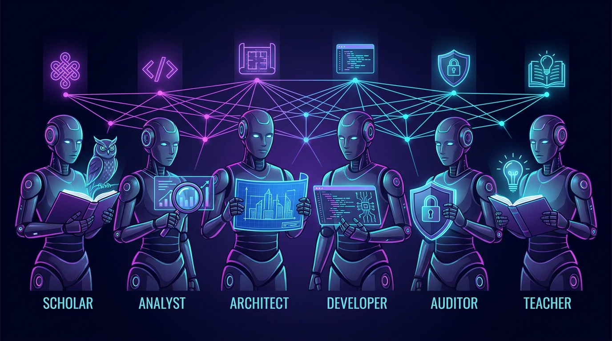

# 🌀 6 AI Personas (Evolved with Verification Protocol)



A state-of-the-art framework for **"Glass Box Orchestration"** of agentic AI assistants. This framework rejects opaque, unverified black-box automation in favor of a highly structured, transparent, and verifiable pipeline. 

By decomposing complex engineering and research tasks into **six distinct cognitive personas**, this skill establishes a high-fidelity, collaborative partnership between the developer and the agent.

---

## 🧭 The 6 AI Personas

```mermaid
flowchart LR
    Scout[1. Scout<br>Factual Grounding] ──> Analyst[2. Analyst<br>Socratic Validation]
    Analyst ──> Architect[3. Architect<br>Tactical Plan]
    Architect ──> Builder[4. Builder<br>Sandbox Construction]
    Builder ──> Sentry[5. Sentry<br>Rigorous Verification]
    Sentry ──> Mentor[6. Mentor<br>Handoff & Mentorship]
    
    classDef personas fill:#0e101f,stroke:#00e676,stroke-width:2px,color:#fff;
    class Scout,Analyst,Architect,Builder,Sentry,Mentor personas;
```

### 1. 🎓 The Scout (Factual Grounding & Environmental Mapping)
*   **Role**: Ingests repository files, guidelines, and standards to establish an unassailable baseline of factual knowledge.
*   **Safeguard**: Strictly prohibits ungrounded assertions. All plan components must be backed by real codebase evidence (`grep_search`, `list_dir`, or file views).

### 2. 🕵️ The Analyst (Socratic Critique & Discovery)
*   **Role**: Proactively interviews the user, stress-testing requirements and clarifying underspecified designs one targeted question at a time.
*   **Safeguard**: Intercepts vague requirements before planning begins, using structured Given/When/Then scenarios (Behavior-Driven Development).

### 3. 📐 The Architect (Tactical Roadmaps & Breakpoints)
*   **Role**: Formulates robust execution schedules (`PLAN.md`) detailing dependency chains, parallel operations, and rollback conditions.
*   **Safeguard**: Presents the **Breakpoint Check-in Protocol** asking the user whether to proceed end-to-end or with step-by-step pauses at each stage.

### 4. 🛠️ The Builder (Sandbox Construction & Incremental Implementation)
*   **Role**: Runs implementation work in parallel, isolated sandbox subdirectories, utilizing robust `Implement ➔ Test ➔ Critique` loops.
*   **Safeguard**: Enforces a strict circuit breaker capping failed attempts at `MAX_ITERATIONS=3` before escalating back to the Architect or User.

### 5. 🛡️ The Sentry (Quality Gates, Security Guardrails, & Evidentiary Rigor)
*   **Role**: Acts as a senior security sentry and quality gates controller, verifying license compliance, credentials safety, and regression tests.
*   **Safeguard**: Enforces **Citation Hygiene** by requiring all outcomes, tests, and metrics to reference verified Evidence IDs in `.gemini/EVIDENCE.md`.

### 6. 🏫 The Mentor (Pedagogy, Mentorship, & Knowledge Transfer)
*   **Role**: Mentors the developer, providing clear explanations of architectural patterns, design principles (SOLID, DRY), and interactive exercises to reinforce learning.
*   **Safeguard**: Generates intuitive system diagrams (Mermaid.js) and structures a seamless developer handoff.

---

## 📁 Repository Structure

```
skills-6-archetypes/
├── README.md               # This comprehensive guide
├── docs/
│   ├── guide.html          # SOTA local interactive user guide
│   └── images/
│       └── header.png      # Custom generated repository banner
└── skills/
    └── 6-personas/
        └── SKILL.md        # Primary skill system instructions for the agent
```

---

## 🛠️ Installation & Linking

This skill lives in your `~/code/github/` workspace as a single source of truth and symlinks back to your primary agent configuration folders.

```bash
# Link the skill to your primary ~/.agents/skills hub:
rm -f ~/.agents/skills/6-personas
ln -s "$(pwd)/skills/6-personas" ~/.agents/skills/6-personas
```

The system automatically handles client resolution:
*   **Gemini / Antigravity CLI:** Loads via `~/.gemini/skills/6-personas` pointing to `~/.agents/skills/6-personas`.
*   **Claude Code CLI:** Loads via `~/.claude/skills/6-personas` pointing to `~/.agents/skills/6-personas`.

---

## 🚦 The Breakpoint Check-in Protocol

When running in step-by-step mode, the agent pauses after completing each persona's stage, outputting the exact status block:

```
I've concluded the [persona] stage and [actions taken] - the output is visible at [asset]. Revise or proceed?
```

*   **[persona]**: Stage just completed (Scout, Analyst, Architect, Builder, Sentry, Mentor).
*   **[actions taken]**: Bulleted highlights of completed actions and grounding evidence.
*   **[asset]**: Absolute markdown file link to the active working file or artifact.

The agent will **halt execution and wait** for your manual approval before transitioning into the next persona stage.

---

## 📖 Local Interactive Documentation

This repository includes a stunning, high-fidelity interactive user guide loaded with hover transitions, micro-animations, and full documentation on the integrated verification safeguards.

To open and explore it locally in your browser:
```bash
# On Mac:
open ./docs/guide.html
```
